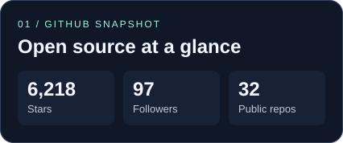
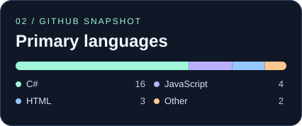

  

<h1 align="center">Hi, I'm LuoLan 👋</h1>

  I build Windows apps with C# and WinUI 3. 
  I’m learning more about .NET and Vue, and I’m happy to chat about JavaScript, C#, and open source.

  <a href="https://idvevent.cn">Portfolio</a>
  &nbsp;·&nbsp;
  <a href="mailto:luolan233@outlook.com">Email</a>

## GitHub snapshot

  
  

  Refreshed daily from GitHub. Repository stats exclude forks.

## Selected projects

- [**图吧工具箱 · TubaTools**](https://github.com/luolangaga/tubatools) — WinUI 3 hardware diagnostics, benchmarking, and real-time monitoring.
- [**WinLand**](https://github.com/luolangaga/WinLand) — A Dynamic Island for Windows 11 with support for plugins.
- [**LanAgent**](https://github.com/luolangaga/AllAgent.NET) — A .NET CodeAct agent with Hyperlight isolation and terminal and desktop interfaces.
