  <picture>
    <source media="(prefers-reduced-motion: reduce)" srcset="assets/meadow-header.svg#still">
    
  </picture>

  <picture>
    <source media="(max-width: 650px)" srcset="assets/about-note-mobile.svg">
    
  </picture>
   
   
  
   

## GitHub snapshot

  <picture>
    <source media="(max-width: 650px)" srcset="assets/github-snapshot-mobile.svg">
    
  </picture>

## Selected projects

- [**图吧工具箱 · TubaTools**](https://github.com/luolangaga/tubatools) — WinUI 3 hardware diagnostics, benchmarking, and real-time monitoring.
- [**WinLand**](https://github.com/luolangaga/WinLand) — A Dynamic Island for Windows 11 with support for plugins.
- [**LanAgent**](https://github.com/luolangaga/AllAgent.NET) — A .NET CodeAct agent with Hyperlight isolation and terminal and desktop interfaces.
